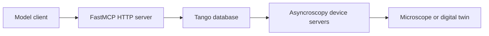

# Asyncroscopy MCP Implementation

The asyncroscopy MCP server lets local or remote model clients call live Tango
device commands through FastMCP.



## Runtime Contract

Start the Tango/device stack:

```bash
uv run startup_scripts/run_servers.py --yaml configs/Spectra300.yaml
```

Start MCP separately:

```bash
uv run startup_scripts/run_mcp.py --yaml configs/mcp.yaml
```

`configs/mcp.yaml` is the explicit MCP config. It contains the Tango endpoint,
the MCP HTTP endpoint, the DATA device address, and the command blocklist.

## What MCP Does At Startup

`MCPServer`:

1. Connects to the Tango database.
2. Lists exported devices.
3. Skips blocked Tango classes.
4. Queries each device's commands.
5. Skips blocked commands.
6. Registers the remaining commands as FastMCP tools.
7. Registers native helper tools such as `list_devices`, `list_data` and
   `view_data`.

There is no package search, source introspection requirement, or separate
AutoScript-specific MCP class.

## Command Names

Tango commands are exposed as MCP tools using the device class and command name.
For example:

```text
SCAN.State
SCAN.Status
AutoScriptMicroscope.acquire_scanned_image
```

The exact tool set depends on which devices are exported in the Tango database
when MCP starts.

## Data Access

Agents never get raw arrays. Two native tools let a model find and look at stored
data through the Tiled HTTP URI reported by the DATA device (so MCP does not need
the microscope filesystem mounted):

- `list_data(kind=None, search=None, limit=20, offset=0)`: the newest keys first,
  each with its kind (`image`, `spectrum`, `spectrum_image`, `stack`, `map`,
  `table`, ...), shape and detector.
- `view_data(key, format="png" | "text", dataset=None, region=None, index=None)`:
  a PNG (images contrast-stretched and downsampled, spectra plotted against energy
  with their peaks marked) or text (shape, units, statistics, a histogram, peaks
  with candidate X-ray lines for EDS, and a small CSV). `region` crops an image in
  pixels or a spectrum in its axis units; `index` picks a frame of a stack or
  4-D dataset; `dataset` picks one array inside a file.

Reads are sliced and strided on the Tiled server under a byte cap, and each call
ends within 20 s, so a 4-D dataset or a run with hundreds of tiles cannot hang the
agent. Acquire commands get the same PNG attached to their result. The drawing
lives in `asyncroscopy/data/views.py`; a new instrument either writes attributes
the built-in kinds understand or registers its own kind (see
`docs/Adding_New_Hardware/new_instrument.md`). Stitched maps in stage
coordinates are read with pyTEMlib's `map_info` and `get_region`.

## Safety Boundary

MCP exposes hardware-control commands, so the YAML blocklist is part of the
runtime safety boundary. Keep destructive or server-management commands blocked:

```yaml
blocked_classes:
  - DataBase
  - DServer
blocked_functions:
  "*":
    - Init
    - Kill
    - RestartServer
```

Add project-specific exclusions before connecting an autonomous model client.
