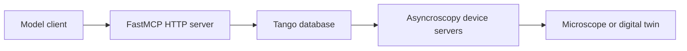

# Asyncroscopy MCP Implementation

The asyncroscopy MCP server lets local or remote model clients call live Tango
device commands through FastMCP.



## Runtime Contract

Start the Tango/device stack:

```bash
uv run startup_scripts/run_servers.py --yaml configs/Spectra300.yaml
```

Start MCP separately:

```bash
uv run startup_scripts/run_mcp.py --yaml configs/mcp.yaml
```

`configs/mcp.yaml` is the explicit MCP config. It contains the Tango endpoint,
the MCP HTTP endpoint, the DATA device address, and the command blocklist.

## What MCP Does At Startup

`MCPServer`:

1. Connects to the Tango database.
2. Lists exported devices.
3. Skips blocked Tango classes.
4. Queries each device's commands and reads its `action_hints` declarations.
5. Skips blocked commands.
6. Builds one `ToolDescriptor` per command (`asyncroscopy/mcp/descriptors.py`): role, risk,
   acts or observes, operator-only, routine in auto mode, stop. The MCP config's
   `safety.risk` comes first, then what the device declares, then the name rules; the
   commands that fell back to the rules are printed as `[safety]` lines. Every device of the
   twin stack declares all its commands on its base class, so for it that list is empty
   (`tests/test_declared_risk.py`); Tango's own `State`, `Status` and `Init` are known by name.
   The rules remain for third-party devices that declare nothing.
7. Registers the remaining commands as FastMCP tools. A call runs through an ordered list
   of interceptors: the preview, logging and the trace, the job checks, the approval gate,
   job stamping, and the token subject.
8. Registers the native tools of its components (`asyncroscopy/mcp/components/`).

The approval decision is one function, `asyncroscopy.safety.decide.decide`, used by the gate,
`find_tools`, `endpoint_info` and the Approvals device. The commands auto mode runs without a
person are the ones their device declares `routine` (the `ElectronMicroscope` base declares its
imaging, spectra, stage moves, beam placement, unblank, stigmator, beam tilt, image shift and
autofocus), unless the MCP config gives `mcp.safety.auto_routine`, which then replaces every
declaration.

`endpoint_info` also carries `tools`: each tool's device, command, canonical role, risk and
whether it acts, as discovery decided them, with `stem_devices` and `map_devices`. Agent programs
read it once per run (`asyncroscopy/agents/catalog.py`) instead of guessing from tool names.

## Replies carry facts

Tool replies say what is true and what to call next; they do not carry instructions for a
model. A job still running when a wait ends has `next_actions`
(`[{"tool": "wait_for_job", "args": {"job_id": ...}}]`); a finished job has
`warnings: [{"code": "finished"}]`; an aborted job has `resume_with` (the `run_job` call that
continues it); an acquisition taken with the beam blanked fails with a JSON error (code
`beam_blanked`) whose `next_actions` retake it. The agent graphs turn these into sentences
for a small model (`asyncroscopy/agents/guidance.py`); other clients read the fields.

## Jobs, waits and skills: one tool per step

Agent traces showed calls that always came together (see
`benchmarks/results/tool_usage_analysis.md`), so the agent endpoint offers one
tool for each step of a job:

- `run_job(device, plan)`: reserve and start in one call. Every successful
  `<device>_reserve` in the trials was followed by its start. The start still
  goes through the approval gate once, and the held request shows the operator
  the reserved plan. Repeating the same `run_job` after approval starts that
  reservation (for the same caller and agent run, `X-Asyncroscopy-Run`: agents
  open a new MCP session per call); repeating it before the
  operator decides files no second request. A denied or expired request, or
  one nobody came back for within two hours, frees the reservation on the next
  `run_job`, `wait_for_job` or `approval_status` from anyone. A start that fails
  releases the reservation it made. Every reply carries the estimate; a plan
  whose estimate is over `mcp.job_limits` (`max_duration_s`,
  `max_dose_e_per_a2`) is refused before it starts, by run_job and by a direct
  `<device>_reserve` alike. The reserve and start run_job makes are traced with
  `via: "run_job"`. The whole call stays under
  25 s, waiting up to 15 s so a short job comes back finished.
- `run_job(device, resume=<reservation_id>)`: continue an aborted job. No
  plan: the reservation holds it, and starting it again (through the gate)
  goes on from the next step. A resume that does not start keeps the
  reservation. A plan and a resume together are refused.
- `wait_for_job(job_id, device=None)`: waits on any job, an instrument job
  (`run_job`, `<device>_start`) or a stitching or scoring job on the analysis
  server named by `mcp.analysis_url`. When the job is done, the reply also
  has its results (`result_keys`, `summary`), so no `*_results` call follows.
  A job device that does not answer is skipped (and named if the job is not
  found elsewhere); an analysis server's error reply is passed on, not
  swallowed. Without `mcp.analysis_url` agents get `analysis_job_status` and
  `analysis_job_results` instead.
- `endpoint_info()`: for agent programs, not given to models: each tool's risk
  as the approval gate sees it (with this deployment's `safety.risk`
  overrides), the job devices, `job_limits` and the analysis server. The agents
  read the analysis server's address from it (so it is configured once, here),
  and the goal checker and benchmarks read the risks. `agent_tools` lists the
  tool-name globs to give a model (for this endpoint and its analysis server),
  computed by the same rules the general agent uses
  (`asyncroscopy/mcp/agent_tools.py`, with the lists of the agent profile
  `asyncroscopy/agents/profiles/default.yaml`, or `mcp.agent_profile`): the curated STEM set on a STEM, else
  every tool but State/Status; never `endpoint_info` or `list_skills`. Other
  harnesses (SciAgentGUI) give the model only these.
- `action_space()`: for agent programs, not given to models: every tool with
  its canonical role (`stage.move`, `acquire.image`, ...), arguments with
  units and ranges, risk and whether it acts or only observes; the readable
  state; each job device's plan schema and example; and which instruments are
  STEM, probe or job devices. See `docs/Operation/action_space.md`.
- Skills: since nearly every run began with `load_skill`, the agent no longer
  asks for skills. Before each model call it adds the skills that match the
  request and what has happened so far (an error, a held call, a data key;
  `asyncroscopy.agents.skill_middleware`); `load_skill` is offered only when a
  matching skill did not fit. See `docs/Operation/agents.md`.

`<device>_reserve`, `_start`, `_job_status`, `_results`, `_release`,
`list_skills` and `load_skill` stay on the endpoint for the `mapping` graph,
SciAgentGUI and other clients. `configs/mcp_dt.yaml` hides from the agent
endpoint the commands no agent needs (Tango `State`/`Status`, DATA's Tiled
administration, `Approvals.request_status` and `list_pending`, and
`Mapper.get_reservation`) with `blocked_functions`; the operator endpoint
(`configs/mcp_operator.yaml`) keeps them. The Approvals commands that decide
or file requests are never offered on an agent endpoint whatever the config
says: the Approvals device declares them operator-only. `OPERATOR_ONLY` in
`asyncroscopy/safety/policy.py` lists only Tango's admin commands (`Init`, `Kill`,
`RestartServer`), which no device declares.

There is no package search, source introspection requirement, or separate
AutoScript-specific MCP class.

## Command Names

Tango commands are exposed as MCP tools using the device class and command name.
For example:

```text
SCAN.State
SCAN.Status
AutoScriptMicroscope.acquire_scanned_image
```

The exact tool set depends on which devices are exported in the Tango database
when MCP starts.

## Data Access

Agents never get raw arrays. Two native tools let a model find and look at stored
data through the Tiled HTTP URI reported by the DATA device (so MCP does not need
the microscope filesystem mounted):

- `list_data(kind=None, search=None, limit=20, offset=0)`: the newest keys first,
  each with its kind (`image`, `spectrum`, `spectrum_image`, `stack`, `map`,
  `table`, ...), shape and detector.
- `view_data(key, format="png" | "text", dataset=None, region=None, index=None)`:
  a PNG (images contrast-stretched and downsampled, spectra plotted against energy
  with their peaks marked) or text (shape, units, statistics, a histogram, peaks
  with candidate X-ray lines for EDS, and a small CSV). `region` crops an image in
  pixels or a spectrum in its axis units; `index` picks a frame of a stack or
  4-D dataset; `dataset` picks one array inside a file.

In png format the text block still carries the summary (statistics, peaks), so
a text-only agent learns what the picture shows. EDS peaks are found from their
counts summed over the detector's line width against the local background (5
sigma, with the exact Poisson tail for counts); a peak that may be a Si escape or
a sum peak of a stronger one is flagged as such rather than named as an element,
and a spectrum with no significant peak says a longer exposure is needed before
an element can be ruled out.

A peak's note names only the lines that could make it: a weaker line of a family
counts when that family's strongest line also has a peak, and a line outside its
element's main family (K if in range, else L, else M) counts when that family's
strongest line has a peak. A peak no such line fits is "unidentified". Below 1 keV
a line may sit a full line width from its peak, since the detector window pushes a
low peak's top up (carbon K, 277 eV, is found at 298 to 308 eV). The "elements most
consistent" line names the fewest elements that explain the peaks, and a peak two
elements fit equally is split between them. Before this (2026-11-03) qwen3:8b read
a carbon peak as calcium and silver, and a Pd particle as Pd, Cd and In.

The window also bends the continuum into a broad rise near 0.6 keV, which the running
background takes for a peak. Below 1.2 keV a peak must therefore also stand 3 sigma above
a smooth (quadratic) curve fitted with it over three line widths each side; one that does
not is listed as "unidentified: a broad rise of the continuum (the detector window), not an
X-ray line". On 288 twin spectra without O or F this cut the spectra read as O or F from
93 to 1, while carbon was still named in 57 of the 63 where it had been (the six lost were
near the detection limit). A strong O peak within a few line widths can still hide a weak
C peak next to it, because it raises C's side-band background. Live at 0b1ce81 the EDS workflows
passed 21 of 21 (`benchmarks/results/workflows_twin_general_0b1ce81_eds.json`), and every
eds_spectrum_elements run called the rise a continuum rise, not O or F.

`list_data` looks through the newest 300 keys in registration order (files
registered after a Tiled outage count as new). `offset` counts keys from the
newest; when `more` is true, call again with `offset = next_offset`. A scan cut
short by its 12 s budget also continues from `next_offset`.

Known gap: vendor metadata stored as XML leaf tags (Thermo `AdornedImage`
files written by `data_writer`) is copied into HDF5 attributes under the
vendor's tag names, which the views do not interpret. Such images show no pixel
size or field of view until the writer also stores `pixel_size_m`.

Reads are sliced and strided on the Tiled server under a byte cap, and each call
ends within 20 s, so a 4-D dataset or a run with hundreds of tiles cannot hang the
agent. Acquire commands get the same PNG attached to their result. The drawing
lives in `asyncroscopy/data/views.py`; a new instrument either writes attributes
the built-in kinds understand or registers its own kind (see
`docs/Adding_New_Hardware/new_instrument.md`). Stitched maps in stage
coordinates are read with pyTEMlib's `map_info` and `get_region`.

## Safety Boundary

MCP exposes hardware-control commands, so the YAML blocklist is part of the
runtime safety boundary. Keep destructive or server-management commands blocked:

```yaml
blocked_classes:
  - DataBase
  - DServer
blocked_functions:
  "*":
    - Init
    - Kill
    - RestartServer
```

Add project-specific exclusions before connecting an autonomous model client.
