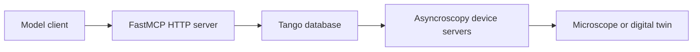

# Asyncroscopy MCP Implementation

The asyncroscopy MCP server lets local or remote model clients call live Tango
device commands through FastMCP.



## Runtime Contract

Start the Tango/device stack:

```bash
uv run startup_scripts/run_servers.py --yaml configs/Spectra300.yaml
```

Start MCP separately:

```bash
uv run startup_scripts/run_mcp.py --yaml configs/mcp.yaml
```

`configs/mcp.yaml` is the explicit MCP config. It contains the Tango endpoint,
the MCP HTTP endpoint, the DATA device address, and the command blocklist.

## What MCP Does At Startup

`MCPServer`:

1. Connects to the Tango database.
2. Lists exported devices.
3. Skips blocked Tango classes.
4. Queries each device's commands.
5. Skips blocked commands.
6. Registers the remaining commands as FastMCP tools.
7. Registers native helper tools such as `list_devices`, `list_data` and
   `view_data`.

## Jobs, waits and skills: one tool per step

Agent traces showed calls that always came together (see
`benchmarks/results/tool_usage_analysis.md`), so the agent endpoint offers one
tool for each step of a job:

- `run_job(device, plan)`: reserve and start in one call. Every successful
  `<device>_reserve` in the trials was followed by its start. The start still
  goes through the approval gate once, and the held request shows the operator
  the reserved plan. Repeating the same `run_job` after approval starts that
  reservation (for the same caller and MCP session); repeating it before the
  operator decides files no second request. A denied or expired request, or
  one nobody came back for within two hours, frees the reservation on the next
  `run_job`, `wait_for_job` or `approval_status` from anyone. A start that fails
  releases the reservation it made. Every reply carries the estimate; a plan
  whose estimate is over `mcp.job_limits` (`max_duration_s`,
  `max_dose_e_per_a2`) is refused before it starts. The whole call stays under
  25 s, waiting up to 15 s so a short job comes back finished.
- `wait_for_job(job_id, device=None)`: waits on any job, an instrument job
  (`run_job`, `<device>_start`) or a stitching or scoring job on the analysis
  server named by `mcp.analysis_url`. When the job is done, the reply also
  has its results (`result_keys`, `summary`), so no `*_results` call follows.
  A job device that does not answer is skipped (and named if the job is not
  found elsewhere); an analysis server's error reply is passed on, not
  swallowed. Without `mcp.analysis_url` agents get `analysis_job_status` and
  `analysis_job_results` instead.
- `endpoint_info()`: for agent programs, not given to models: each tool's risk
  as the approval gate sees it (with this deployment's `safety.risk`
  overrides), the job devices, `job_limits` and the analysis server. The agents
  read the analysis server's address from it (so it is configured once, here),
  and the goal checker and benchmarks read the risks.
- Skills: since nearly every run began with `load_skill`, the agent no longer
  asks for skills. Before each model call it adds the skills that match the
  request and what has happened so far (an error, a held call, a data key;
  `asyncroscopy.agents.skill_middleware`); `load_skill` is offered only when a
  matching skill did not fit. See `docs/Operation/agents.md`.

`<device>_reserve`, `_start`, `_job_status`, `_results`, `_release`,
`list_skills` and `load_skill` stay on the endpoint for the `mapping` graph,
SciAgentGUI and other clients. `configs/mcp_dt.yaml` hides from the agent
endpoint the commands no agent needs (Tango `State`/`Status`, DATA's Tiled
administration, `Approvals.request_status` and `list_pending`, and
`Mapper.get_reservation`) with `blocked_functions`; the operator endpoint
(`configs/mcp_operator.yaml`) keeps them. The Approvals commands that decide
or file requests are never offered on an agent endpoint whatever the config
says (`OPERATOR_ONLY` in `asyncroscopy/safety/policy.py`).

There is no package search, source introspection requirement, or separate
AutoScript-specific MCP class.

## Command Names

Tango commands are exposed as MCP tools using the device class and command name.
For example:

```text
SCAN.State
SCAN.Status
AutoScriptMicroscope.acquire_scanned_image
```

The exact tool set depends on which devices are exported in the Tango database
when MCP starts.

## Data Access

Agents never get raw arrays. Two native tools let a model find and look at stored
data through the Tiled HTTP URI reported by the DATA device (so MCP does not need
the microscope filesystem mounted):

- `list_data(kind=None, search=None, limit=20, offset=0)`: the newest keys first,
  each with its kind (`image`, `spectrum`, `spectrum_image`, `stack`, `map`,
  `table`, ...), shape and detector.
- `view_data(key, format="png" | "text", dataset=None, region=None, index=None)`:
  a PNG (images contrast-stretched and downsampled, spectra plotted against energy
  with their peaks marked) or text (shape, units, statistics, a histogram, peaks
  with candidate X-ray lines for EDS, and a small CSV). `region` crops an image in
  pixels or a spectrum in its axis units; `index` picks a frame of a stack or
  4-D dataset; `dataset` picks one array inside a file.

In png format the text block still carries the summary (statistics, peaks), so
a text-only agent learns what the picture shows. EDS peaks are found from their
counts summed over the detector's line width against the local background (5
sigma, with the exact Poisson tail for counts); a peak that may be a Si escape or
a sum peak of a stronger one is flagged as such rather than named as an element,
and a spectrum with no significant peak says a longer exposure is needed before
an element can be ruled out.

`list_data` looks through the newest 300 keys in registration order (files
registered after a Tiled outage count as new). `offset` counts keys from the
newest; when `more` is true, call again with `offset = next_offset`. A scan cut
short by its 12 s budget also continues from `next_offset`.

Known gap: vendor metadata stored as XML leaf tags (Thermo `AdornedImage`
files written by `data_writer`) is copied into HDF5 attributes under the
vendor's tag names, which the views do not interpret. Such images show no pixel
size or field of view until the writer also stores `pixel_size_m`.

Reads are sliced and strided on the Tiled server under a byte cap, and each call
ends within 20 s, so a 4-D dataset or a run with hundreds of tiles cannot hang the
agent. Acquire commands get the same PNG attached to their result. The drawing
lives in `asyncroscopy/data/views.py`; a new instrument either writes attributes
the built-in kinds understand or registers its own kind (see
`docs/Adding_New_Hardware/new_instrument.md`). Stitched maps in stage
coordinates are read with pyTEMlib's `map_info` and `get_region`.

## Safety Boundary

MCP exposes hardware-control commands, so the YAML blocklist is part of the
runtime safety boundary. Keep destructive or server-management commands blocked:

```yaml
blocked_classes:
  - DataBase
  - DServer
blocked_functions:
  "*":
    - Init
    - Kill
    - RestartServer
```

Add project-specific exclusions before connecting an autonomous model client.
