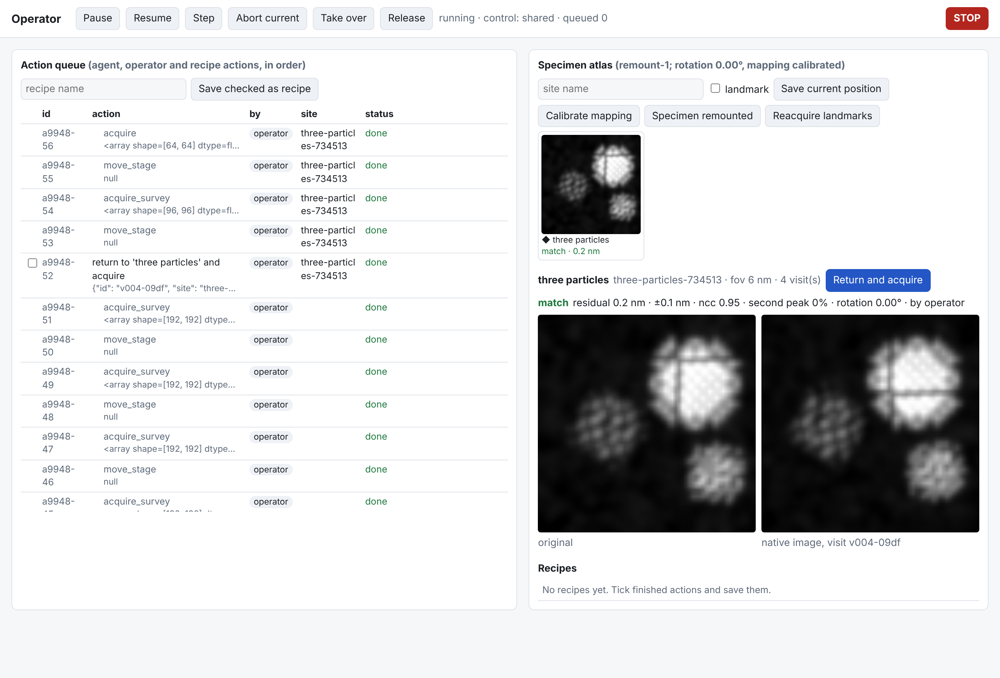

# Supervision, recipes and the specimen atlas



This adds three things to the MCP server:

1. **One action queue** shared by the operator and the agent.
2. **Recipes**: a successful run you can save, edit, rehearse on the twin, and then run on the microscope.
3. **A specimen atlas** where "return to this spot" is a verified action.

The queue design is borrowed from AMADEUS's action queue. The pixel-to-stage
mapping is borrowed from AMADEUS's `stage_mapping.py`, but here a mapped
coordinate is only a starting guess.

Turn it on in the MCP config (`configs/mcp_dt.yaml` has a full example):

```yaml
mcp:
  supervision:
    enabled: true
    dir: outputs/supervision
    policy:
      require_approval: ["*set_column_valves"]
      stage_limits: {x: [-1.0e-6, 1.0e-6], y: [-1.0e-6, 1.0e-6]}
```

Then open `http://<mcp-host>:8000/supervision/ui`. SciAgentGUI can use the
same HTTP API. `asyncroscopy/supervision/http.py` lists the endpoints.

## One queue for the operator and the agent

- Every device tool the agent calls through MCP becomes an action in one FIFO
  queue. Actions the operator queues from the page or API go into the same
  queue.
- Each action records:
  - who asked for it: `agent`, `operator` or `recipe`
  - which atlas site it targets
  - its status: `queued`, `awaiting_approval`, `running`, `done`, `error`,
    `skipped`, `refused` or `rejected`
- Composite actions record each instrument step as a child action. These
  include "return to site", calibration and recipe runs.
- **Pause**, **step**, **skip** and **abort** take effect between actions,
  including between the child steps of a composite action.
- **Take over** pauses the queue and rejects agent requests. Each rejected
  request is still recorded. The operator's own actions keep running.
  **Release** hands control back. History is kept throughout.
- **STOP** does not go through the queue. It runs the configured
  `stop_commands` immediately, by default `instrument.blank_beam`, and then
  pauses the queue.
- Reads (`*_get_*`) bypass the queue so the agent can still look while the
  queue is paused.
- History is appended to `history.jsonl`, one line per state change. Recipes
  are built from it.

## Limits live in the control layer

`policy` is checked on every action, including child steps of composite
actions, before anything reaches the instrument:

| Rule | What it does |
|---|---|
| `forbid` | Refuses matching tools. |
| `stage_limits`, `max_step_xy_m` | Refuses moves outside the limits. Nothing moves. |
| `arg_limits` | Bounds named arguments, for example `dwell_time`. |
| `require_approval` | The action waits at the head of the queue until the operator approves or denies it. |
| `require_twin_validation` | A recipe runs on a real instrument only after that exact version ran successfully on a twin. |

The agent's MCP tools cannot approve, resume, take over or change the policy.
If you set `operator_token`, the operator API requires it.

## Recipes

1. Tick the finished actions of a good run on the page and save them as a
   recipe.
2. Recipes are stored as JSON under `recipes/`. Tools are written in role form,
   for example `instrument.move_stage` and `atlas.return_to_site`, so one recipe
   resolves on both a twin and a real microscope.
3. Use `${name}` placeholders for parameters.
4. Before a recipe starts, the server checks that this instrument has every
   tool and detector the recipe needs.
5. Each successful run is recorded against the recipe's content hash. Editing
   a recipe changes the hash, so the new version has to be rehearsed on the
   twin again.

The Blockly editor is left out for now. Edit recipes with
`PUT /supervision/recipes/<name>`.

## Verified return to a site

`atlas_return_to_site`, or **Return and acquire** on the page, runs these
steps:

1. Move to the predicted position: the saved coordinate, adjusted by the
   current mount transform.
2. Take a lower-magnification survey and find the stored reference in it.
   After a remount whose angle hasn't been fitted yet, this includes a rotation
   search.
3. Centre what it found, using the calibrated stage-to-image Jacobian
   (**Calibrate mapping**).
4. Re-acquire at native settings and register against the original image.
   Repeat until the residual is within tolerance.
5. Report `match` only if all of these hold:
   - the normalized cross-correlation is high enough
   - no second position scores close to the best one (repetitive structure
     fails this)
   - the image quadrants agree on the position
   - the position uncertainty is small

   Otherwise the result is `ambiguous`, `no_match` or `not_converged`, and the
   agent is told not to treat the position as the site.
6. Record the visit in the atlas, whether it matched or not. Each visit stores
   its image, settings, evidence, and the action and run it came from.

**After a remount:**

1. Click **Specimen remounted**.
2. Click **Reacquire landmarks**. This finds each landmark site with a wide
   survey and fits the rotation and translation of the new mount.
3. Return to any other site as usual.

## Remount benchmark

Run it on the synthetic scope (seconds, no Tango):

```bash
uv run python -m asyncroscopy.atlas.benchmark --sites 10 --rotation 4 --shift 3e-6 -2e-6
```

Run it on the DigitalTwin stack:

```bash
uv run python -m asyncroscopy.atlas.benchmark --backend twin
```

The benchmark saves sites and landmarks, then remounts the specimen. The
synthetic scope rotates and shifts it; the twin uses its new `specimen_mount`
attribute. It then reacquires the landmarks and returns to each site, and
writes `benchmark.md`, which reports:

- how many sites it found
- the true error of each match, from the simulator's ground truth
- how many times it was **confidently wrong**: a `match` more than FOV/4 from
  the real site

Synthetic results (FOV 2 µm, 128 px, 20 nm stage noise, remount 4° and
(3, −2) µm):

| Seed | Found | Confidently wrong | Median error | Fitted rotation | Periodic-patch decoys |
|---|---|---|---|---|---|
| 7 | 9/10 | 0 | 20 nm | 4.09° | refused |
| 11 | 10/10 | 0 | 21 nm | 3.99° | refused |
