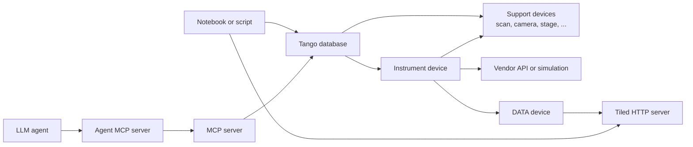

# Architecture

One running setup is a stack. A stack has one Tango database, one instrument device, the support devices that instrument uses, and optionally a DATA device with a Tiled server. Clients reach every device through the Tango database.

## Parts

| Part | Code | What it does |
|---|---|---|
| Tango database | `tango.databaseds.database` | Holds device names, properties and addresses. Default port 9094. |
| Instrument device | `asyncroscopy/instruments/<kind>/<file>.py` | The public command API for one instrument. Talks to the vendor API or a simulation. |
| Support devices | `asyncroscopy/instruments/<kind>/hardware/`, `detectors/` | Hold the settings of one part of the instrument, for example dwell time on SCAN. |
| DATA device | `asyncroscopy/data/data.py` | Starts Tiled and registers each saved acquisition with it. |
| Tiled server | started by DATA | Serves saved files over HTTP. Default port 9091. |
| MCP server | `asyncroscopy/mcp/mcp_server.py` | Turns every Tango command in the database into an MCP tool. Default port 8000. |
| Agent MCP server | `asyncroscopy/mcp/agent_mcp_server.py` | Runs an LLM agent swarm on the tools of one or more MCP servers. Default port 8002. |

## Class layers

The instrument code has three layers:

1. `Instrument` (`asyncroscopy/instruments/instrument.py`) is the base for every instrument. It declares `read_instrument_type`, `_init_device_attributes`, `_connect` and `_disconnect`, and gives every instrument the `Connect` and `Disconnect` commands.
2. A family base adds the public commands for one kind of instrument. `ElectronMicroscope` and `SPMMicroscope` are the two that exist.
3. A vendor class fills in the family's `_helper` methods for one vendor API or simulation, for example `AutoScriptMicroscope`, `JeolMicroscope`, `DigitalTwin` or `JupiterMicroscope`.

Public commands live in the family base. They validate input, read settings from the support devices, then call a `_helper`. So all vendors in a family show the same commands to clients.

## Names

`startup_scripts/run_servers.py` names everything from the keys in the YAML config:

| Thing | Name |
|---|---|
| Support device with key `scan` | `asyncroscopy/scan/default` |
| The instrument | `asyncroscopy/instrument/default` |
| Server process for key `scan` | `SCAN/scan_instance`, run as `uv run python -u -m <module_name> scan_instance` |
| Address property on the instrument | `scan_device_address = asyncroscopy/scan/default` |

The device names are the same in every stack. Two stacks therefore need two Tango databases. See [scaling](scaling.md).

## Startup order

1. The Tango database starts.
2. The runner registers every device and writes the instrument's properties.
3. The support devices start. The runner waits until each one answers `ping()`.
4. DATA starts Tiled, if `tiled.autostart` is true.
5. The instrument starts last, because it opens proxies to the support devices in `init_device`.

The MCP server and the agent start separately, after the stack is up.

## Data path

Acquisition commands do not send pixels over Tango. The instrument saves the data to a file, DATA registers the file with Tiled, and the command returns the Tiled key. The client reads the data from Tiled with that key. See [data and Tiled](Tiled_server/data_integration.md).
